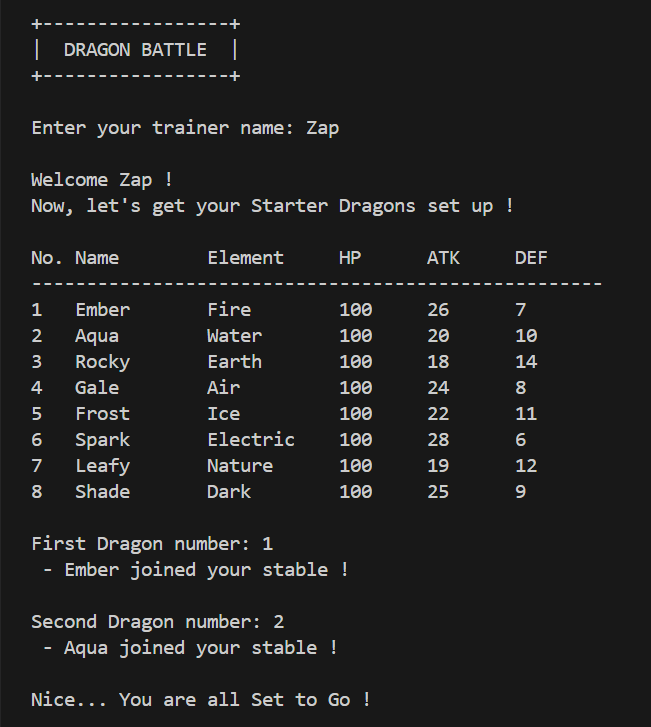
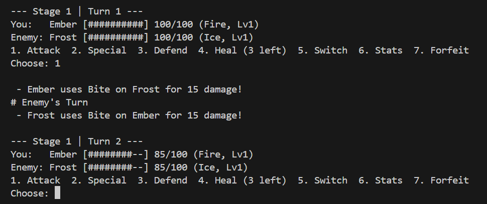
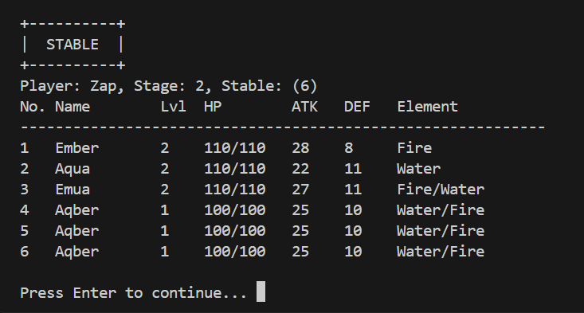

# Turn-Based Elemental Battle Simulator

A turn-based, single-player, terminal dragon battler inspired by Dragon City. The game is called
**Dragon Battle** on screen. Built in C++ for the Object-Oriented Programming course project
(25CS2001, IIITDM Kancheepuram, faculty: B Sivaselvan).

You pick two starter dragons, choose a squad of up to three for each fight, beat three enemy
stages, level your dragons up after every win and breed new dragons from your stable.

## Features

- Catalog of 8 elemental starter dragons (Fire, Water, Earth, Air, Ice, Electric, Nature, Dark)
- Turn-based battles with Attack, Special (3-turn cooldown), Defend, Heal, Switch, Stats and Forfeit
- A random-action enemy AI and three stages (the last one is the boss stage)
- Squad selection: up to 3 dragons from your stable fight as copies, so a battle never damages the stable
- Level-ups after every win and breeding of two dragons into a new one (stable holds up to 6)
- Input validation on every prompt: letters and out-of-range numbers are rejected, not crashed on

## Build and run

You need a C++ compiler with C++11 support (g++ is what the team used). From the repo root:

```
g++ -std=c++11 -Wall -Iinclude src/main.cpp src/Move.cpp src/Dragon.cpp src/Player.cpp src/Battle.cpp src/Game.cpp src/Utils.cpp -o dragon
```

Then run `dragon.exe` (Windows) or `./dragon` (Linux, macOS, WSL).

The program prints "[Dragon destroyed]" lines whenever a dragon object is destroyed. This is
intentional: it shows constructors, destructors and `new[]`/`delete[]` at work.

## How to play

1. Enter a trainer name (3 to 10 characters) and pick 2 starter dragons.
2. Use the main menu: **Battle**, **Breed Dragons**, **My Stable**, **How to Play**, **Exit**.
3. Before a battle, pick up to 3 dragons from your stable.
4. Damage is `attack + move power - target defense` (minimum 1). Winning a stage levels up your
   squad and unlocks the next stage. Losing or forfeiting costs nothing.

The full rules and screens are in [`docs/DESIGN.md`](docs/DESIGN.md).

## Repo layout

```
include/   headers (the shared interface between the classes)
src/       implementations and main.cpp
docs/      DESIGN.md (rules and screens), ISSUES.md (task list), screenshots/
```

## Classes and OOP concepts

| Class | Owner | What it does |
|---|---|---|
| `Move` | A | One attack with a power and a cooldown |
| `Dragon` | A | Stats, two `Move` objects, damage, healing, breeding and level-up operators |
| `Player` | B | A trainer and a dynamic stable of dragons (also used for the enemy team and the squad) |
| `Battle` | C | The turn loop between two `Player` objects, including the enemy AI |
| `Game` | D | Menus, the starter catalog, squad selection and enemy teams |
| `Utils` | D | Safe input, HP bar, banner and pause helpers |

| Concept (mid-sem) | Where it is used |
|---|---|
| Encapsulation | Private data and getters in `Dragon`, `Player`, `Move` |
| Constructors | `Dragon` (default, parameterized, copy), `Move`, `Player` (parameterized, deep copy) |
| Destructors | `Dragon` (prints a message), `Player` (`delete[]`), `Game` |
| Composition | `Dragon` has `Move moves[2]`; `Player` has a `Dragon` array; `Game` has the catalog and player |
| Dynamic memory | `Player::grow`, `Player` copy constructor and `operator=`, `Game::buildCatalog` |
| `this` pointer | Chained `return *this` functions, `Player::operator=`, prefix `++` |
| Friend functions | `showStats`, `Dragon` stream operators, `Player` `operator<<` (the stable table) |
| Operator overloading | `-=`, `+`, `++`, `==`, `<`, `>`, `<<`, `>>` in `Dragon` |
| Static members | `Dragon::totalCreated`, `Player::MAX_DRAGONS`, `Game::SQUAD_MAX` |

## Screenshots

| Catalog and starter pick | Battle turn | Stable table |
|---|---|---|
|  |  |  |

All screenshots used in the report are in [`docs/screenshots/`](docs/screenshots/).

## Team

| Member | Name | Roll number | Owns | Branch |
|---|---|---|---|---|
| A | Vedula Laxmana Venkata Pranay | CS25B1063 | `Move`, `Dragon` | `feature/dragon` |
| B | Lokeshwaran K | CS25B1087 | `Player` | `feature/player` |
| C | Keerthivasan P | CS25B1065 | `Battle` | `feature/battle` |
| D | Pavan V S | CS25B1056 | `Game`, `Utils`, `main`, Git and integration | `feature/game`, `feature/game-latest` |

The Git workflow is in [`CONTRIBUTING.md`](CONTRIBUTING.md) and the task list is in
[`docs/ISSUES.md`](docs/ISSUES.md).

## Status

- [x] Mid-sem build: classes, constructors and destructors, composition, friend functions, `this`, dynamic memory, operator overloading, static members
- [ ] Final build: inheritance, virtual functions, templates, STL, streams, exceptions, file save/load

### Known limitations (mid-sem version)

- Elements have no effect on damage yet. An element is only a label.
- Breeding joins the parents' element names as text, so a heavily bred dragon can get a very long element name.
- Progress is kept in memory only. There is no saving.
- The screens use plain text without colours.

### Planned for the final phase

- Inheritance and virtual special attacks per element, with an element effectiveness table that also decides a bred dragon's element
- A `Team<T>` class template, and `vector` and `map` from the STL
- Streams, saving and loading progress from a file, and exception handling
- A cleaner, colourised interface